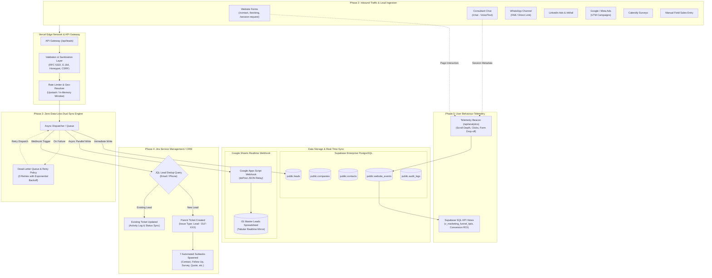
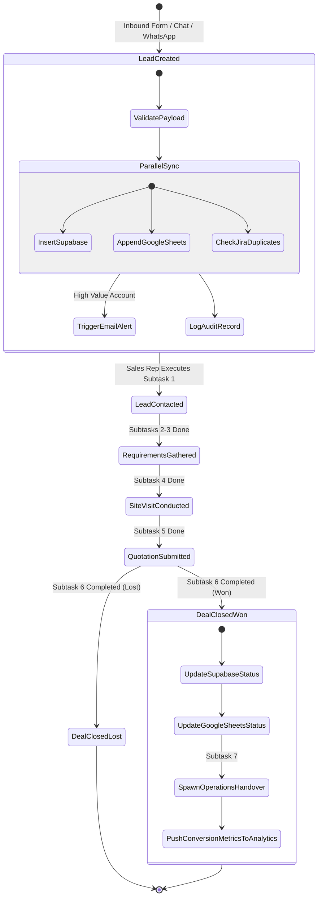

# ISI Security — Enterprise Digital Presence Management System Architecture

**Document Version:** 2.4.0 (Enterprise Production Blueprint)  
**Author:** Senior Solutions Architect & Engineering Guild  
**Scope:** Architecture, Dual-Sync Data Flow, Jira CRM Lifecycle, Telemetry, Automation State Machines, Monitoring & Production Roadmap  

---

## 1. Enterprise Architecture Blueprint



---

## 2. Lead Tracking & Attribution Engine (Phase 2)

### 2.1 Universal Lead Data Contract

Every inbound lead regardless of source is normalized into a strict, unified JSON schema:

```json
{
  "lead_id": "c1f78e90-84bf-42f5-b223-38827fa11850",
  "full_name": "Vikram Malhotra",
  "email": "v.malhotra@apolloclinics.com",
  "phone": "+919876543210",
  "company_name": "Apollo Health City",
  "designation": "Head of Facilities & Physical Security",
  "source": "website_booking_modal",
  "campaign": "q4_healthcare_security_expansion",
  "utm_source": "linkedin",
  "utm_medium": "sponsored_content",
  "utm_campaign": "healthcare_security_audit_2026",
  "utm_term": "hospital_security_services",
  "utm_content": "hero_cta_audit_banner",
  "page_url": "https://www.isisecurity.in/sectors/healthcare",
  "referrer": "https://www.linkedin.com/",
  "ip_address": "103.211.54.12",
  "geo_country": "India",
  "geo_city": "Bengaluru",
  "notes": "Looking for 24/7 guarded security and access control audit for 3 campus locations.",
  "status": "new",
  "timestamp": "2026-11-19T14:42:00.000Z"
}
```

### 2.2 Omnichannel Source Taxonomy

| Source Identifier | Channel Category | Ingestion Flow | Attribution Tags |
| :--- | :--- | :--- | :--- |
| `website_contact` | Website Inbound | Inline form on `/contact` | `utm_source`, `page_url` |
| `website_booking` | High-Intent Inbound | Executive booking modal on `/booking` | Survey date, facility tier |
| `consultant_chat` | Conversational Capture | Interactive chat at `/chat` | Chat transcript, user budget |
| `whatsapp_click` | Direct Messaging | Click on floating action button (`wa.me`) | Device type, landing route |
| `linkedin_inmail` | B2B Paid Outbound | LinkedIn Lead Gen Form Sync | Campaign ID, Company Headcount |
| `calendly_sync` | Self-Scheduled Survey | Calendly Webhook Relay | Scheduled appointment ISO time |
| `field_sales_manual`| Direct Sales Team | Admin Portal Lead Insertion | Sales Rep ID, Territory |

---

## 3. Dual Database Sync Engine (Phase 3)

### 3.1 High-Availability Architecture

```
                       [Incoming Validated Lead]
                                  │
                  ┌───────────────┴───────────────┐
                  ▼                               ▼
       [Branch A: Supabase]             [Branch B: Google Sheets]
                  │                               │
         PostgreSQL Transaction           HTTPS Webhook Relay
                  │                               │
            ┌─────┴─────┐                   ┌─────┴─────┐
            ▼           ▼                   ▼           ▼
         Success     Failure             Success     Failure
            │           │                   │           │
            ▼           ▼                   ▼           ▼
        Audit Log    Dead-Letter        Audit Log   Retry Queue
                     Queue                          (Exp. Backoff)
```

### 3.2 Resilience & Anti-Data-Loss Guarantees
1. **Idempotent Upsert:** Database writes utilize PostgreSQL `ON CONFLICT (email) DO UPDATE` or unique UUID keys to prevent duplicates on network resends.
2. **Exponential Backoff:** If the Google Sheets Apps Script endpoint returns `5xx` or `ECONNRESET`, the request is retried at intervals: `1s`, `4s`, `16s`.
3. **Dead-Letter Audit Trail:** Any payload failing 3 consecutive attempts is written to `public.audit_logs` with severity level `'CRITICAL'` and alerts the DevOps webhook.

---

## 4. Jira CRM Lifecycle & Dedup Engine (Phase 4)

### 4.1 De-duplication Protocol via JQL

Before creating any Jira issue, the `/api/jira` worker executes a JQL query:
```jql
project = "DLF" AND (cf[10050] ~ "v.malhotra@apolloclinics.com" OR cf[10051] ~ "+919876543210") ORDER BY created DESC
```
- **Scenario A (Lead Exists):**
  - Add an internal comment: `"Repeat inquiry submitted on 2026-11-19 via website_booking_modal. Updated notes: [...]"`
  - Increment inquiry counter.
  - Transition status to `"Re-engaged"` if previously marked Closed/Lost.
- **Scenario B (New Lead):**
  - Create parent ticket in Project `DLF` (Issue Type: `Lead`).
  - Automatically instantiate the 7 standard operational subtasks:

```
[DLF-1042] Lead: Vikram Malhotra - Apollo Health City (Physical Security RFP)
  ├── [DLF-1043] 1. Initial Contact & Discovery Call (SLA: 2 Hours)
  ├── [DLF-1044] 2. Follow-Up Touchpoint 1 (SLA: 24 Hours)
  ├── [DLF-1045] 3. Gather Detailed Security Requirements & Scope
  ├── [DLF-1046] 4. Conduct Physical Site Visit & Vulnerability Assessment
  ├── [DLF-1047] 5. Formulate & Submit Commercial Quotation
  ├── [DLF-1048] 6. Contract Negotiation & Deal Closure
  └── [DLF-1049] 7. Operational Handover & Deployment Briefing
```

---

## 5. User Behaviour Tracking & Analytics (Phase 5)

### 5.1 Telemetry Event Ingestion Pipeline

The client-side `useAnalytics` hook transmits un-intrusive beacon events to `/api/analytics`:

| Event Name | Trigger Condition | Payload Parameters |
| :--- | :--- | :--- |
| `page_view` | React Router navigation | `path`, `referrer`, `viewport_width`, `session_id` |
| `button_click` | Interaction with any primary CTA | `button_id`, `button_text`, `target_url` |
| `scroll_depth` | Page scroll triggers (25%, 50%, 75%, 100%) | `depth_percentage`, `time_to_depth` |
| `form_start` | Focus on first form input field | `form_id`, `field_focused` |
| `form_abandon` | Window unload before form submission | `form_id`, `fields_completed`, `time_spent` |
| `resource_download`| Click on brochures, audit checklists, whitepapers | `file_name`, `file_format`, `source_page` |

### 5.2 Real-Time Analytical KPI View

SQL View `v_marketing_funnel_kpis` computes the conversion funnel in real-time:
```sql
SELECT 
    DATE_TRUNC('day', we.created_at) AS report_date,
    COUNT(DISTINCT we.session_id) AS total_sessions,
    COUNT(DISTINCT CASE WHEN we.event_name = 'form_start' THEN we.session_id END) AS forms_started,
    COUNT(DISTINCT l.id) AS total_leads_captured,
    ROUND((COUNT(DISTINCT l.id)::DECIMAL / NULLIF(COUNT(DISTINCT we.session_id), 0)) * 100, 2) AS session_to_lead_cvr,
    COUNT(DISTINCT CASE WHEN l.status = 'closed_won' THEN l.id END) AS deals_won,
    COALESCE(SUM(l.deal_value), 0) AS pipeline_won_value
FROM public.website_events we
LEFT JOIN public.leads l ON DATE_TRUNC('day', we.created_at) = DATE_TRUNC('day', l.created_at)
GROUP BY 1 ORDER BY 1 DESC;
```

---

## 6. Enterprise API Architecture (Phase 7)

```
/api
├── /forms
│   └── POST /api/forms/submit     # Public form validation & honeypot screening
├── /leads
│   ├── POST /api/leads            # Central lead capture & sync dispatcher
│   ├── GET  /api/leads            # Authenticated lead retrieval with filtering
│   └── PATCH /api/leads/:id       # Update status (Qualified, Opportunity, Won, Lost)
├── /analytics
│   └── POST /api/analytics        # Low-latency beacon for client-side events
├── /jira
│   ├── POST /api/jira/sync        # Trigger manual or webhook-based Jira ticket generation
│   └── GET  /api/jira/status/:id  # Fetch live Jira ticket & subtask resolution state
├── /sheets
│   └── POST /api/sheets/append    # Direct Google Sheets write relay
├── /webhooks
│   ├── POST /api/webhooks/jira    # Inbound Jira issue status changes -> sync back to Supabase
│   └── POST /api/webhooks/calendly# Inbound Calendly scheduling events -> auto-lead creation
└── /audit
    ├── GET  /api/audit/health     # Service health check (Supabase, Jira, Sheets latency)
    └── GET  /api/audit/logs       # Query system sync exceptions & dead-letter queue
```

---

## 7. Lifecycle Automation Workflows (Phase 8)



---

## 8. Monitoring & Health Architecture (Phase 11)

### 8.1 Unified Health Check Endpoint (`/api/audit/health`)

Monitors all upstream and downstream service connections:

```typescript
// Sample Response Structure: /api/audit/health
{
  "status": "healthy",
  "timestamp": "2026-11-19T14:45:00.000Z",
  "environment": "production",
  "version": "2.4.0",
  "services": {
    "supabase_database": {
      "status": "up",
      "latency_ms": 32,
      "connection_pool": "healthy"
    },
    "google_sheets_webhook": {
      "status": "up",
      "latency_ms": 194,
      "last_sync_timestamp": "2026-11-19T14:42:01.000Z"
    },
    "jira_cloud_api": {
      "status": "up",
      "latency_ms": 312,
      "quota_remaining": "98.4%"
    },
    "groq_consultant_engine": {
      "status": "up",
      "latency_ms": 240,
      "active_model": "openai/gpt-oss-120b"
    }
  },
  "queue_metrics": {
    "dead_letter_count": 0,
    "pending_retries": 0
  }
}
```

---

## 9. 4-Week Step-by-Step Implementation Roadmap (Phase 12)

```
┌────────────────────────────────────────────────────────────────────────┐
│ WEEK 1: FOUNDATION & DATABASE MIGRATION                                 │
├────────────────────────────────────────────────────────────────────────┤
│ • Apply docs/audit/01_complete_supabase_schema.sql to Supabase         │
│ • Configure Row Level Security (RLS) policies for Anon vs Service Role │
│ • Provision Vercel encrypted environment variables                     │
│ • Setup Google Apps Script Webhook on master Google Spreadsheet        │
├────────────────────────────────────────────────────────────────────────┤
│ WEEK 2: API GATEWAY & ZERO-DATA-LOSS DUAL SYNC                          │
├────────────────────────────────────────────────────────────────────────┤
│ • Deploy unified /api/leads, /api/forms, /api/sheets endpoints          │
│ • Implement corporate email validation & honeypot spam protection      │
│ • Implement exponential backoff retry queue for Sheets Webhook         │
│ • Conduct integration stress test (100 concurrent lead submissions)   │
├────────────────────────────────────────────────────────────────────────┤
│ WEEK 3: JIRA CRM AUTOMATION & TELEMETRY                                │
├────────────────────────────────────────────────────────────────────────┤
│ • Implement Jira Cloud REST API v3 integration with JQL dedup          │
│ • Automate parent ticket creation (DLF-XXX) + 7 operational subtasks   │
│ • Embed useAnalytics telemetry hook across all 70+ website routes      │
│ • Setup bidirectional Jira webhook (/api/webhooks/jira) for status sync│
├────────────────────────────────────────────────────────────────────────┤
│ WEEK 4: AUDIT REPORTS, SECURITY LOCKDOWN & GO-LIVE                     │
├────────────────────────────────────────────────────────────────────────┤
│ • Deploy /api/audit/health monitoring dashboard                        │
│ • Enforce strict Content Security Policy (CSP) & HSTS in vercel.json   │
│ • Run automated Lighthouse Core Web Vitals CI check on staging         │
│ • Point DNS A/CNAME records to Vercel production edge network          │
│ • Production sign-off & technical handover                             │
└────────────────────────────────────────────────────────────────────────┘
```
